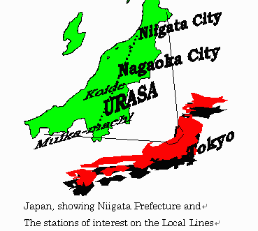

If you don't have a car, the IUJ campus bus is how you get to Urasa Station, the shops and the hospital. It doesn't run all day, so learn the timetable early.

*Where these places are, relative to Tokyo. Urasa is IUJ's own station; Koide and Muikamachi are the next stations along the local lines.*

---

## The IUJ Campus Bus System

IUJ runs its own buses, managed by the Office of General Affairs (FT-OGA). They aren't public buses: they carry IUJ students, faculty, staff and visitors, with some help for off-campus families as a secondary service. The timetable is on IUJ's [Bus, Train Schedules](https://www2.iuj.ac.jp/oss/current-students/iuj-bus-train-schedules/) page, and changes are announced by email.

Stops have names, not route numbers. The main ones:

| Stop | What's there |
|---|---|
| **Toda Store** | Toda grocery store, the first stop after IUJ on every run; handy for SD4, with a 7-Eleven nearby |
| **Hospital** | Yamato Hospital and Uonuma Kikan Hospital; see [[Nearby Clinics & Hospitals]] |
| **Tenno-machi** | Near Moegi Clinic and many off-campus family apartments |
| **Station** (駅, Urasa Station) | Shinkansen and local trains |
| **Supermarket** | キューピット大和 (Cupid Yamato) supermarket in Urasa, the main grocery run |
| **City Office** (市役所) | Minami-Uonuma City Office and Daishi Hokuetsu Bank (now inside the City Office building) |
| **Kodomo-en** | Childcare centre and schools. On the way to the station the bus stops here only if someone asks before it leaves IUJ |
| **MSA** | The MSA dormitory building; not every bus goes here |

**A bus holds 32 people, babies included.** If it's full, wait for the next one. Large items such as strollers or shelves aren't allowed, except luggage when you're arriving at or leaving IUJ for good. Times are approximate, so be at your stop **5 minutes early**.

> ⚠️ **The timetable changes often.** FT-OGA revised the whole weekday and weekend timetable on 1 June 2026 (longer hours, more shopping-bus runs, the Sunday Gyomu Super bus rerouted through campus) and corrected it on 8 June. A 13 July 2026 email said night buses would be **suspended** to save labour and fuel costs, but the timetable attached to that same email was unchanged. The timetable on IUJ's site is still the 8 June version as of October 2026, and the times below come from it. If you hear of a change, trust the latest email.

---

## Weekday Buses

From the 8 June 2026 timetable: **15 runs a day**, Monday to Friday. The first leaves IUJ at 7:50 and the last at 22:10, getting back at 22:44, so late returns are covered and there's no separate night bus. Every run stops at Toda Store, Hospital, Tenno-machi and Urasa Station. Only the mid-day and early evening runs go on to the Supermarket and City Office, so check the timetable before you rely on one. Kodomo-en is request-only on the way out.

---

## Weekend Shopping Buses

At weekends there are shopping buses to AEON Muikamachi (イオン六日町店) on Saturdays and to Gyomu Super near Koide on Sundays. A separate, more frequent bus to Urasa Station runs on both days.

- **Saturday AEON bus:** 4 fixed runs. Off-campus and SD4 residents have priority on the first one.
- **Sunday Gyomu Super bus:** 6 fixed runs, each with priority for a set group: **1st**, off-campus families; **3rd and 5th**, off-campus and SD4 residents; **2nd, 4th and 6th**, on-campus residents.
- **Boarding:** you need a ticket, handed out about **10 minutes before departure**. The ticket shows which return bus you have priority on. If you try another one, you board only if there's room after the ticket holders ("Gentlemen's rules"). If there's no seat, you get back at your own expense.
- The 32-passenger limit (babies included) is a legal limit and applies at weekends too.
- **Graduation day has its own timetable.** On 27 June 2026, the graduation ceremony, FT-OGA replaced the regular service with a one-off timetable, with some runs reserved for graduating students and faculty. Expect a similar announcement before each graduation.

---

## Taxi

Taxis wait at Urasa Station. There's no Uber or ride-sharing here.

- The fare from Urasa Station to IUJ is roughly ¥1,000-1,500 (students' estimate)
- A taxi is your option for late nights when the bus has stopped
- Taxis don't wait around all night, so book one in advance for a late return, or take whatever is at the station rank
- **The 10 PM weekday night taxi was discontinued on 1 June 2026** (per FT-OGA), when the bus hours were extended to cover late returns. Because of the July email above, check the current timetable, or ask OSS, before a very late return.

---

## Getting Around Without a Car

**In rough order of usefulness:**
1. **Bicycle:** best for supermarket runs and station trips outside winter. See [[Bicycle — Buying, Renting, Storage, Winter|Bicycle]]
2. **IUJ campus bus:** for the Shinkansen, the supermarket and the City Office
3. **Weekend shopping bus:** AEON on Saturdays, Gyomu Super on Sundays
4. **A ride with a student who has a car:** often the easiest way to do bigger trips or errands outside bus times. See [[Carpooling — Student Networks]]
5. **Taxi:** for emergencies and late nights

---

## Bus Rules

From IUJ's Bus Guide:
- Board and get off only at bus stops. Don't run after the bus or try to flag it down.
- Everyone wears a seatbelt, small children included, and nobody stands while the bus is moving.
- No eating, smoking or drinking from open containers. Take your rubbish with you.
- While you wait, stay off private property and don't block the entrances of Lawson or Toda Store.
- Never cross around the bus. It's a common cause of accidents.

---

## Useful Japanese

| Japanese | Romaji | Meaning |
|---|---|---|
| バス停 | Basu tei | Bus stop |
| 時刻表 | Jikokuhyō | Timetable |
| 終バス | Shū basu | Last bus |
| 乗り換え | Norikae | Transfer |
| 市役所 | Shiyakusho | City Office |
| 駅 | Eki | Station |

---

## Related Articles
- [[IC Cards — Suica & Pasmo Setup]]
- [[Urasa Station — Full Guide & Quirks]]
- [[Shinkansen Strategy]]
- [[Bicycle — Buying, Renting, Storage, Winter|Bicycle]]
- [[Carpooling — Student Networks]]
- [[Local Grocery Options]]

---

## 🗣️ Senior Submissions
> *Have a tip, correction, or experience to add? Click the **✏️ pencil button** at the top of the page. If you are correcting something, highlight that passage first and it goes into the form for you.*

- Whether night buses were actually cut in summer 2026 (the 13 July email and its attached timetable disagree)
- Local taxi company names and numbers for late-night situations
- Tips for getting around in winter when cycling isn't viable
